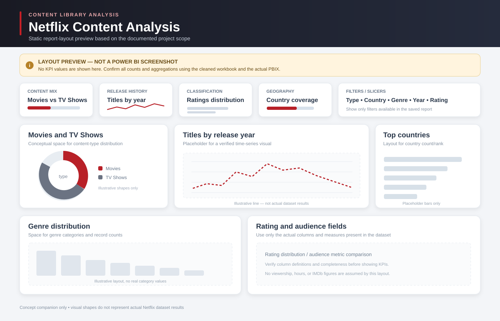

# Netflix Content Analysis

<p align="center">
  
</p>

<p align="center">
  
  
  
  
</p>

## 1. Project Overview

This project explores a supplied Netflix content dataset using Microsoft Excel, Power Query and Power BI.

The objective is to prepare the data, build an analytical report and understand patterns in content types, genres, ratings, countries and release years.

The project follows a complete data analytics workflow, from initial data inspection to dashboard development and business insights.

> **Note:** Findings describe the supplied project dataset. They should not be interpreted as current statistics about Netflix's live catalogue.

## 2. Business Problem

Understanding the distribution and characteristics of streaming content can help stakeholders explore catalogue composition and content trends.

This project uses data preparation, transformation and visualisation techniques to examine the available Netflix dataset and answer relevant analytical questions.

## 3. Project Objectives

- Inspect the raw dataset and identify data-quality issues.
- Clean and standardise data using Excel and Power Query.
- Prepare the dataset for reporting and analysis.
- Build a Power BI data model.
- Create measures and KPIs using DAX.
- Explore content types, genres, ratings, countries and release years.
- Present findings through interactive report visuals.

## 4. Business Questions

- How is the dataset distributed between Movies and TV Shows?
- Which genres appear most frequently?
- Which content ratings are most common?
- How does title distribution vary across countries?
- How has the number of titles varied by release year?
- What patterns can be explored using the available rating and audience fields?

## 5. Dataset Overview

The project includes the following data files:

| File | Description |
|---|---|
| [Raw Netflix Dataset](Raw_Netflix_Dataset.xlsx) | Original dataset |
| [Cleaned Netflix Dataset](Cleaned_Netflix_Dataset.xlsx) | Prepared dataset |
| [Data Quality Report](Cleaned_Data_Quality_Report.xlsx) | Data-quality assessment |

The analysis uses available fields such as title, type, director, cast, country, date added, release year, rating, duration and listed genres.

## 6. Project Workflow

### Step 1 — Data Understanding

- Reviewed the original dataset.
- Examined columns, data types and available records.
- Identified missing values and potential inconsistencies.

### Step 2 — Excel Data Quality Assessment

- Inspected missing and duplicate values.
- Reviewed data completeness and consistency.
- Documented data-quality observations.

### Step 3 — Power Query Transformation

- Cleaned and standardised selected fields.
- Applied data transformation steps.
- Prepared the dataset for Power BI reporting.

### Step 4 — Power BI Data Modeling

- Loaded the prepared data.
- Organised the reporting model.
- Prepared fields for analytical reporting.

### Step 5 — DAX Measures and KPIs

- Developed measures for report analysis.
- Prepared calculations for content distribution and comparisons.
- Used DAX to support interactive reporting.

### Step 6 — Dashboard Development

- Created report visuals.
- Added filters for exploring the available dataset.
- Organised the report around the project business questions.

## 7. Dashboard Preview



*This is a conceptual dashboard layout preview, not an actual screenshot from Power BI Desktop. Refer to the PBIX file for the interactive report.*

**[Open the Power BI Dashboard](Netflix_Content_Analysis_Dashboard.pbix)**

## 8. Main Report Areas

| Analysis area | Purpose |
|---|---|
| Content Type | Explore Movies and TV Shows |
| Genre Analysis | Examine genre distribution |
| Ratings | Explore content rating categories |
| Country Analysis | Compare available country information |
| Release Year | Examine release-year patterns |
| Interactive Filters | Explore data by available categories |

## 9. Tools and Technologies

| Tool | Role in the project |
|---|---|
| Microsoft Excel | Initial data review and quality assessment |
| Power Query | Data cleaning and transformation |
| Power BI | Data modeling and dashboard development |
| DAX | Measures and KPI calculations |

## 10. Project Documentation

The `docs` folder contains detailed reports covering the project workflow.

| Document | Description |
|---|---|
| [01 — Project Overview](docs/01_Project_Overview.pdf) | Project scope and overall workflow |
| [02 — Data Collection and Understanding](docs/02_Data_Collection_and_Understanding.pdf) | Dataset review and understanding |
| [03 — Excel Data Quality Assessment](docs/03_Excel_Data_Quality_Assessment.pdf) | Data-quality review |
| [04 — Power Query Cleaning and Transformation](docs/04_Power_Query_Data_Cleaning_and_Transformation.pdf) | Data preparation process |
| [05 — Power BI Data Model](docs/05_Power_BI_Data_Model.pdf) | Data-model documentation |
| [06 — DAX Measures and KPIs](docs/06_DAX_Measures_and_KPIs.pdf) | Measure and KPI documentation |
| [07 — Dashboard Design and Visualization](docs/07_Dashboard_Design_and_Visualization.pdf) | Dashboard design approach |
| [08 — Business Questions and Insights](docs/08_Business_Questions_and_Insights.pdf) | Analytical questions and findings |
| [09 — Business Recommendations](docs/09_Business_Recommendations.pdf) | Recommendations based on project analysis |
| [10 — Final Project Report](docs/10_Final_Project_Report.pdf) | Consolidated project report |

## 11. Project Structure

```text
netflix-content-analysis/
│
├── Raw_Netflix_Dataset.xlsx
├── Cleaned_Netflix_Dataset.xlsx
├── Cleaned_Data_Quality_Report.xlsx
├── Netflix_Content_Analysis_Dashboard.pbix
│
├── docs/
│   ├── 01_Project_Overview.pdf
│   ├── 02_Data_Collection_and_Understanding.pdf
│   ├── 03_Excel_Data_Quality_Assessment.pdf
│   ├── 04_Power_Query_Data_Cleaning_and_Transformation.pdf
│   ├── 05_Power_BI_Data_Model.pdf
│   ├── 06_DAX_Measures_and_KPIs.pdf
│   ├── 07_Dashboard_Design_and_Visualization.pdf
│   ├── 08_Business_Questions_and_Insights.pdf
│   ├── 09_Business_Recommendations.pdf
│   ├── 10_Final_Project_Report.pdf
│   └── README.md
│
├── images/
│   └── dashboard-layout-preview.svg
│
└── README.md
```

## 12. How to Run the Project

**Prerequisites:** Microsoft Excel and Power BI Desktop.

1. Clone or download this repository.
2. Open `Raw_Netflix_Dataset.xlsx` to review the original data.
3. Review `Cleaned_Data_Quality_Report.xlsx`.
4. Open `Cleaned_Netflix_Dataset.xlsx` to inspect the prepared data.
5. Open `Netflix_Content_Analysis_Dashboard.pbix` in Power BI Desktop.
6. Explore the report pages and interactive filters.
7. Refer to the PDF reports in the `docs` folder for detailed explanations.

## 13. Scope and Limitations

- Results depend on the supplied dataset and its available fields.
- The analysis does not represent Netflix's current live catalogue.
- Dataset patterns do not establish cause-and-effect relationships.
- Revenue or subscription conclusions are outside the scope unless supported by relevant data.
- The dashboard layout image is conceptual; the PBIX file is the interactive report.

## 14. Author

**Shanmukh Koyya**

- **GitHub:** [shanmukhkoyya](https://github.com/shanmukhkoyya)
- **LinkedIn:** [linkedin.com/in/shanmukh-koyya](https://www.linkedin.com/in/shanmukh-koyya/)
- **Email:** [shanmukhkoyya1234@gmail.com](mailto:shanmukhkoyya1234@gmail.com)