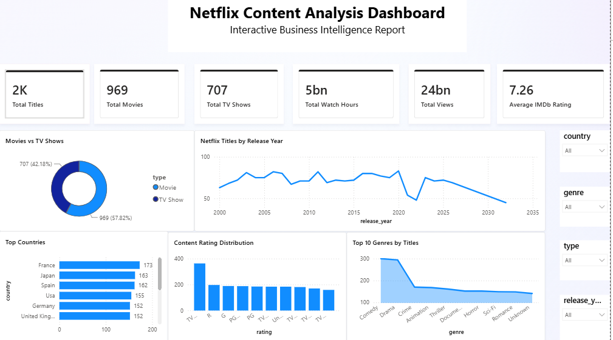

# Netflix Content Analysis

**Tools:** Excel · Power Query · Power BI · DAX

This project explores a supplied Netflix content dataset and presents patterns in title types, genres, ratings, countries, release years, and audience-related fields.

> Findings describe the dataset used for this project; they are not current statistics about Netflix's live catalogue.

## Questions explored
- How is the dataset split between Movies and TV Shows?
- Which genres and ratings appear most often?
- How does title count vary by release year and country?
- How do the available rating and audience fields vary across groups?

## Workflow
1. Review the original dataset and identify data-quality issues.
2. Clean and standardise fields in Excel and Power Query.
3. Prepare the data model in Power BI.
4. Create measures and KPIs with DAX.
5. Build report pages and filters to explore the data.
6. Record findings and recommendations in the project documentation.

## Dashboard preview

Open the PBIX file in Power BI Desktop to interact with the report.

## Files
| File or folder | Purpose |
|---|---|
| [Power BI report](Netflix_Content_Analysis_Dashboard.pbix) | Interactive report file |
| [Raw dataset](Raw_Netflix_Dataset.xlsx) | Starting dataset |
| [Cleaned dataset](Cleaned_Netflix_Dataset.xlsx) | Prepared data |
| [Data-quality report](Cleaned_Data_Quality_Report.xlsx) | Data-quality review |
| [Dashboard image](images/dashboard.png) | Preview image |
| [Project documentation](docs/) | Workflow, data quality, model, measures, analysis, and recommendations |

## Main report areas
- Content mix by type and rating
- Genre and country distribution
- Release-year patterns
- Rating and audience metrics available in the dataset
- Filters for release year, type, country, genre, and rating

## Tools by stage
| Stage | Tool |
|---|---|
| Data review and preparation | Excel |
| Cleaning and transformation | Power Query |
| Data model and report | Power BI |
| Measures and KPIs | DAX |

## How to review
1. Open Netflix_Content_Analysis_Dashboard.pbix in Power BI Desktop.
2. Explore the report pages and interactive filters.
3. Compare the visuals with the cleaned dataset and data-quality report.
4. Use the docs folder to review the workflow and findings.

## Limitations
- Results depend on the supplied dataset and its fields.
- Patterns in this dataset do not necessarily describe Netflix's current catalogue or audience.
- Revenue or subscription conclusions should not be made unless the relevant data and assumptions are documented.

## Author
**Shanmukh Koyya** · [GitHub](https://github.com/shanmukhkoyya) · [LinkedIn](https://www.linkedin.com/in/shanmukh-koyya/) · [Email](mailto:shanmukhkoyya1234@gmail.com)
