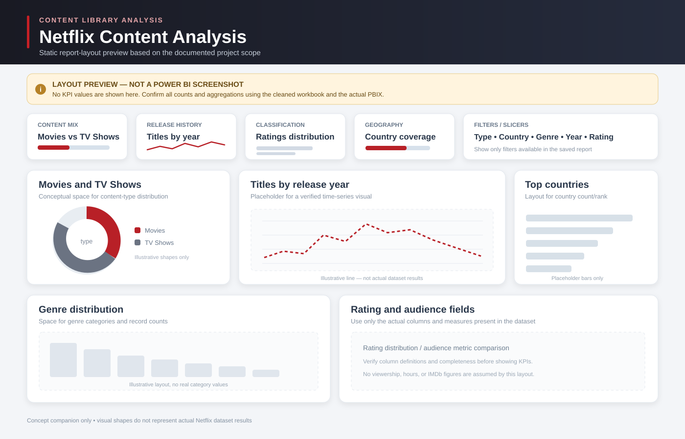

# THE CATALOGUE EDIT
### A streaming-library data story

## Editor's brief

A supplied streaming catalogue is explored by format, genre, content rating, country and release year. This is an offline project dataset—not Netflix's current live catalogue.

## Production storyboard

<table>
<tr><td align="center" width="33%"><h2>01</h2><strong>INGEST</strong> Excel source</td><td align="center" width="33%"><h2>02</h2><strong>INSPECT</strong> Data-quality review</td><td align="center" width="33%"><h2>03</h2><strong>PREPARE</strong> Power Query</td></tr>
<tr><td align="center"><h2>04</h2><strong>MODEL</strong> Power BI structure</td><td align="center"><h2>05</h2><strong>VISUALISE</strong> DAX & report</td><td align="center"><h2>06</h2><strong>DOCUMENT</strong> PDF reports</td></tr>
</table>

## Browse the production assets

| Cut | Deliverable | File |
|---|---|---|
| Original | Raw workbook | [Open XLSX](Raw_Netflix_Dataset.xlsx) |
| Prepared | Cleaned workbook | [Open XLSX](Cleaned_Netflix_Dataset.xlsx) |
| Quality | Data-quality report | [Open XLSX](Cleaned_Data_Quality_Report.xlsx) |
| Dashboard | Power BI report | [Open PBIX](Netflix_Content_Analysis_Dashboard.pbix) |
| Documentation | Report collection | [Open index](docs/README.md) |

## Visual direction

Concept artwork for the report layout; not a screenshot exported from Power BI.

## Questions for the analyst

- 🎬 Is the supplied catalogue weighted toward movies or TV shows?
- 🎭 Which genres appear most often?
- 🔞 How are content ratings distributed?
- 🌍 Which countries appear in the dataset?
- 📆 How does release-year coverage vary?

<strong>Reviewer's screening checklist</strong>

- Compare raw and cleaned workbook structures.
- Inspect the quality report and documented cleaning decisions.
- Open the PBIX and review model relationships.
- Check measures and visual interactions.
- Reconcile reported patterns to the source data.

**Interpretation limit:** Catalogue composition does not reveal audience preference, viewing behaviour or business causation.